# VR-AR-3

Скрипты на Python (`bpy`) для курса **«Технологии виртуальной реальности»** — 15 кейсов из задания *«Blender и программирование для VR на Python»*.

Каждый кейс — **отдельный самодостаточный скрипт**: очищает сцену, выполняет задание, создаёт **камеру, направленную на объект (Track To)** и свет, настраивает рендер — сразу можно нажать **F12 (Render Image)**.

> Проверено на **Blender 5.2.2 LTS** (подходит Blender 3.x–5.x).

---

## Как запустить

1. Откройте Blender → вкладка **Scripting** (Text Editor).
2. **Open** → выберите файл `caseNN.py`.
3. **Run Script** (`Alt+P`).
4. **Render → Render Image** (`F12`) — объект гарантированно в кадре.

Где посмотреть вывод задания:

- в текстовом блоке **`Вывод_КейсNN`** в Text Editor (появляется после запуска);
- в консоли Blender: **Help → Toggle System Console** (откройте до запуска).

Настройки рендера в каждом скрипте: **EEVEE, 1920×1080, PNG** (для кейса 3 — Cycles, т.к. нужен стереорежим multiview).

---

## Файлы

| Скрипт | Кейс | Что делает |
|--------|------|------------|
| `case01.py` | Создание примитива для VR-сцены | куб `VR_Cube` на высоте 1 м |
| `case02.py` | PBR-материал (Principled BSDF) | `VR_Material`, синий, roughness 0.3 |
| `case03.py` | Стереокамера (multiview) | `VR_Camera`, IPD 0.065 м, STEREO_3D |
| `case04.py` | Оптимизация меша (Decimate) | 1280 → 320 треугольников (ratio 0.25) |
| `case05.py` | Инстансинг циклом | сетка 5×5, `Tile_0_0`…`Tile_4_4` |
| `case06.py` | Освещение (Sun) | `VR_Sun`, мощность 4.0 |
| `case07.py` | Анимация (ключевые кадры) | полный оборот за 60 кадров |
| `case08.py` | Экспорт в glTF (GLB) | `vr_scene.glb` |
| `case09.py` | Позиции глаз (stereo cameras) | расчёт по IPD, проверка расстояния |
| `case10.py` | Поле зрения (FOV) | ширина кадра и доля объекта |
| `case11.py` | Кватернионы | поворот взгляда на 90° по Z |
| `case12.py` | Бюджет кадра | 72/90/120 Гц → мс на кадр |
| `case13.py` | LOD по расстоянию | LOD0/LOD1/LOD2/culling |
| `case14.py` | Полигональный бюджет | 125 объектов максимум, 150 → превышение |
| `case15.py` | Motion-to-photon | сумма задержек vs порог 20 мс |

Также в репозитории:

- `Скрины/1.png` … `Скрины/15.png` — рендер-скриншоты каждого кейса;
- `Скрины/vr_scene.glb` — экспорт сцены кейса 8 (glTF 2.0, бинарный).

---

## Кейсы и результаты

### Кейс 1. Создание примитива для VR-сцены
Куб `VR_Cube` на высоте 1 м, камера и свет добавлены.

```
Создан объект: VR_Cube
Вершин: 8
```

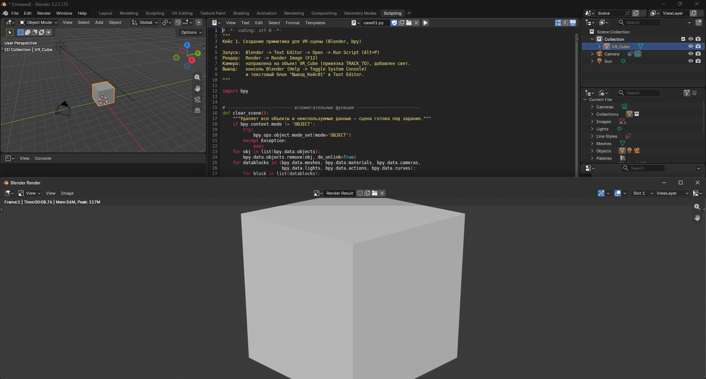

### Кейс 2. PBR-материал (Principled BSDF)
Синий материал `VR_Material` с шероховатостью 0.3.

```
Материал назначен: VR_Material
Материалов на объекте: 1
```

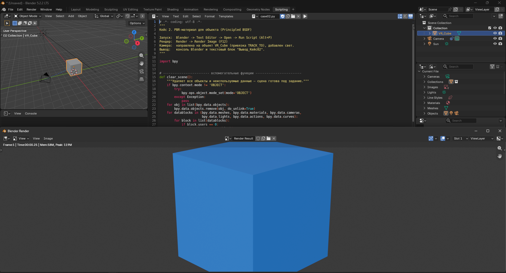

### Кейс 3. Стереокамера для VR (multiview)
Камера `VR_Camera`, стереорежим STEREO_3D, межзрачковое расстояние 65 мм — рендер формирует кадр для каждого глаза.

```
Стерео включено: True
Межзрачковое расстояние, м: 0.065
```

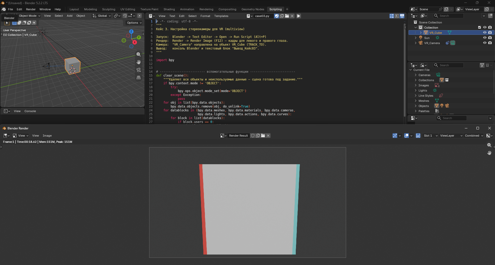

### Кейс 4. Оптимизация меша под 90 FPS (Decimate)
Икосфера упрощается до 25% треугольников.

```
Было треугольников: 1280
Целевое число (ratio 0.25): 320
```

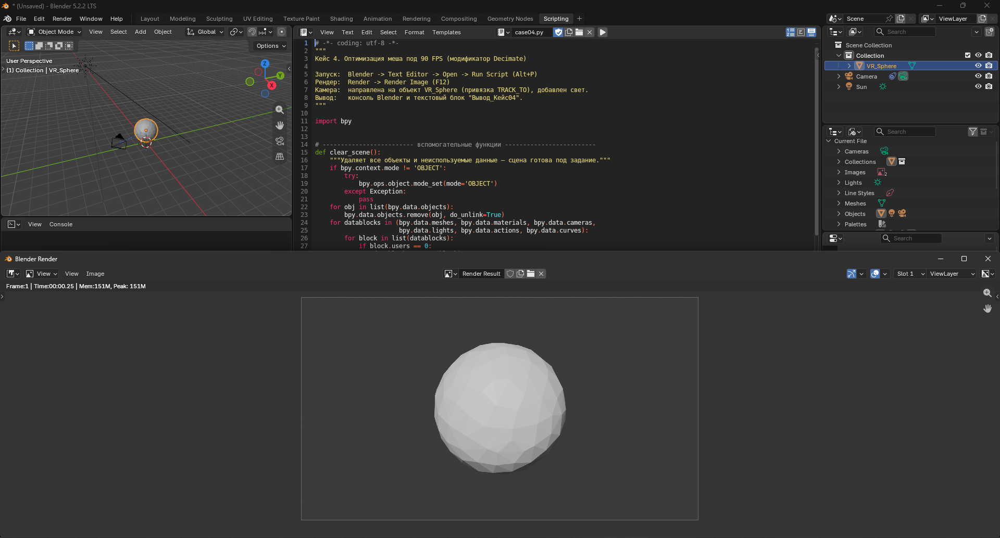

### Кейс 5. Инстансинг: сетка 5×5
25 кубов `Tile_0_0`…`Tile_4_4` с шагом 2 м, камера направлена на центральный.

```
Создано объектов: 25
```

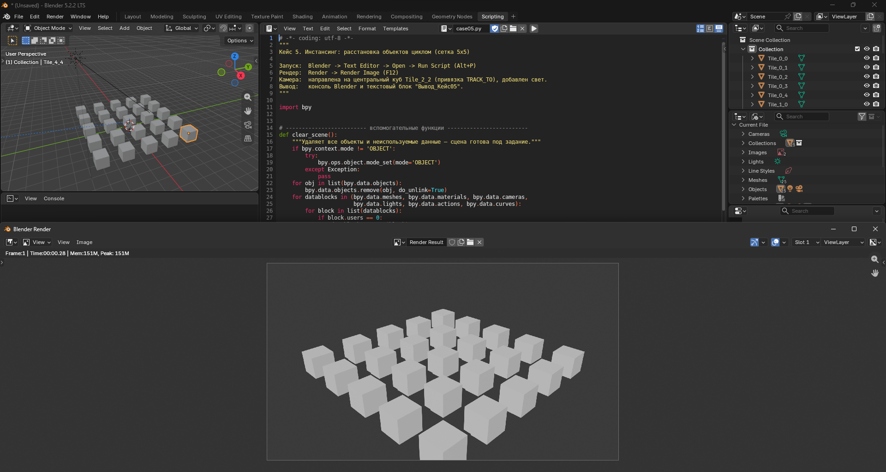

### Кейс 6. Освещение VR-сцены (Sun)
Направленный источник `VR_Sun` мощностью 4.0.

```
Источник света: VR_Sun
Тип: SUN | Мощность: 4.0
```

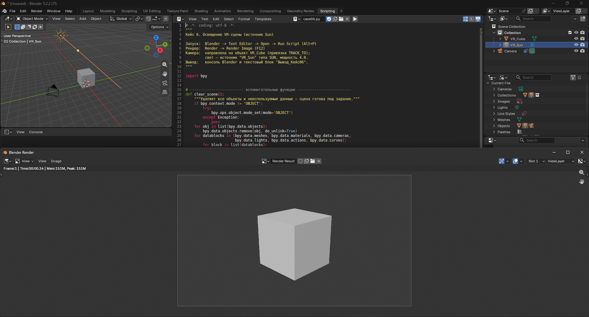

### Кейс 7. Анимация вращения (ключевые кадры)
Полный оборот вокруг Z с 1-го по 60-й кадр (2 ключевых кадра). На рендере — текущий кадр 15 (середина анимации).

```
Анимация: кадры 1 - 60
Ключевых кадров вставлено: 2
```

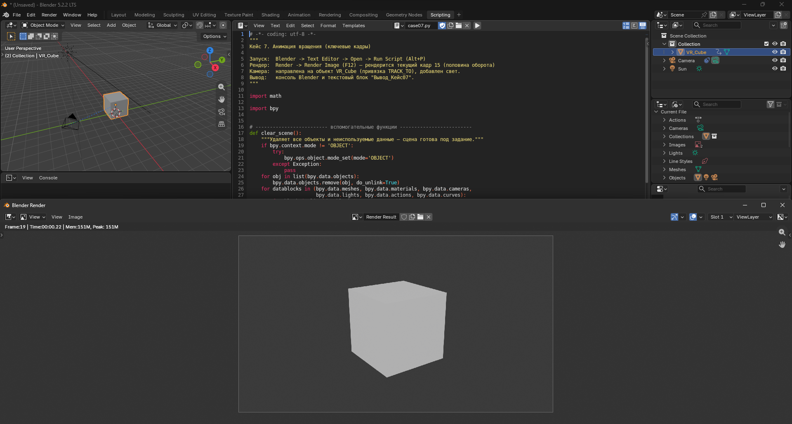

### Кейс 8. Экспорт сцены в glTF (GLB)
Сцена (геометрия, материал, анимация, камера, свет) экспортируется в `vr_scene.glb` — файл лежит в `Скрины/vr_scene.glb`.

```
Экспортировано в: ...\vr_scene.glb
```

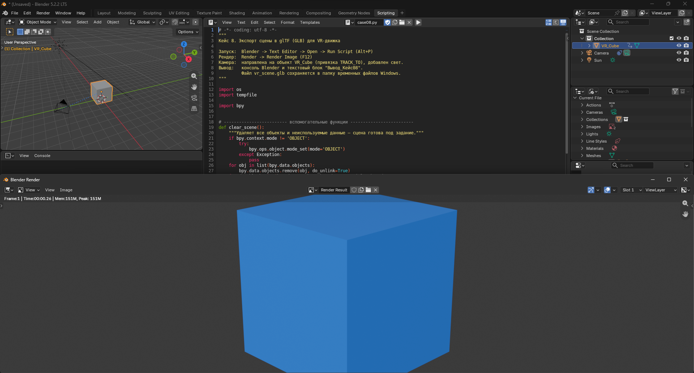

### Кейс 9. Стереокамеры: позиции глаз
Расчёт позиций по голове `(0, -2, 1.6)` и IPD 0.065 м (NumPy).

```
Левый глаз:  [-0.0325 -2.      1.6   ]
Правый глаз: [ 0.0325 -2.      1.6   ]
Расстояние между камерами: 0.065 м
```

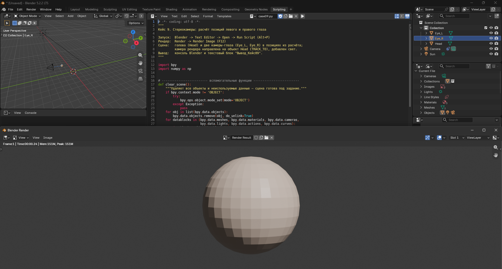

### Кейс 10. Поле зрения (FOV) и размер объекта в кадре
Камера с FOV 100° смотрит на объект шириной 2 м с 5 м.

```
FOV = 100.0 град, расстояние = 5.0 м
Ширина видимой области: 11.92 м
Объект шириной 2.0 м занимает 16.8% ширины кадра
```

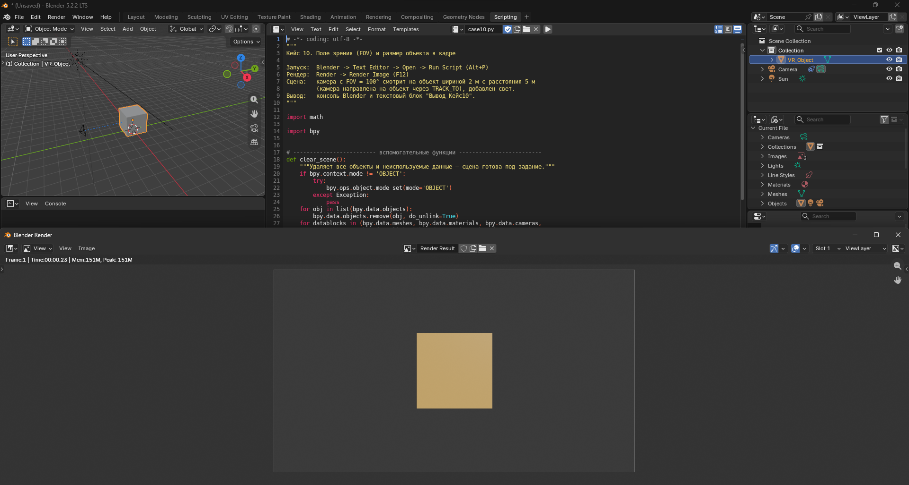

### Кейс 11. Кватернионы: поворот вектора взгляда
Зелёный луч — взгляд «вперёд» (+Y), оранжевый — после поворота на 90° по Z («влево», −X).

```
Кватернион (w,x,y,z): [0.707 0.    0.    0.707]
Вектор взгляда до поворота: [0, 1, 0]
После поворота на 90 по Z: [-1.  0.  0.]
```

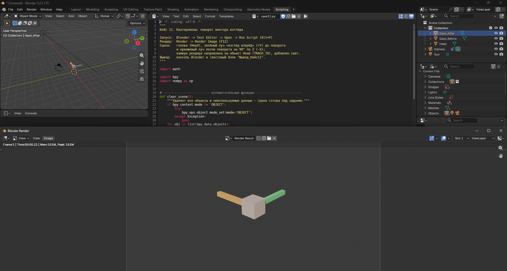

### Кейс 12. Бюджет кадра для частот VR-дисплея
Столбцы — бюджеты кадра для 72/90/120 Гц и фактическое время рендера 9.5 мс.

```
72 Гц -> бюджет кадра 13.89 мс
90 Гц -> бюджет кадра 11.11 мс
120 Гц -> бюджет кадра 8.33 мс
Рендер 9.5 мс при 90 Гц (11.11 мс): успеваем
```

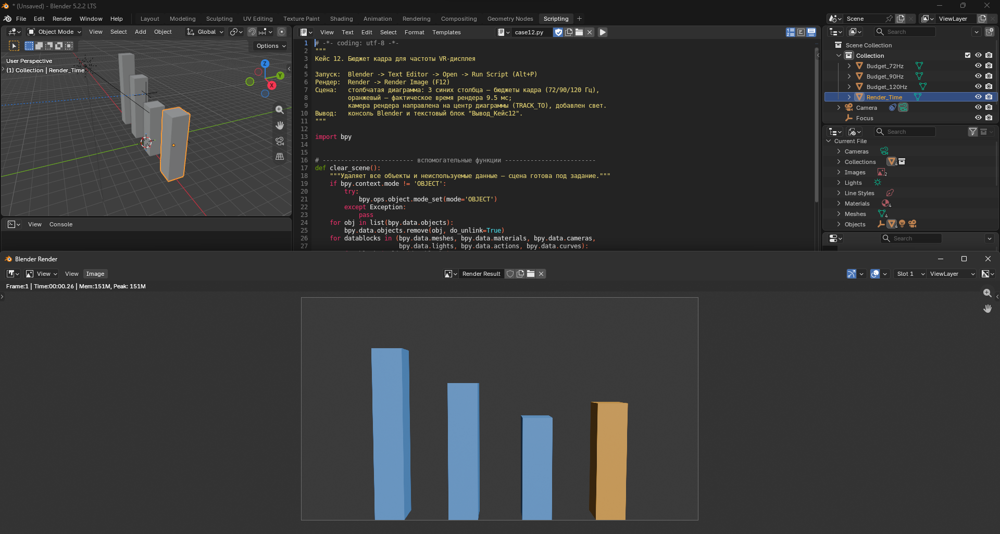

### Кейс 13. Выбор уровня детализации (LOD)
Три сферы — LOD0 (1280 тр.), LOD1 (80 тр.), LOD2 (20 тр.).

```
  2 м -> LOD0 (высокая детализация)
 10 м -> LOD1 (средняя)
 35 м -> LOD2 (низкая)
 80 м -> culled (не рендерится)
```

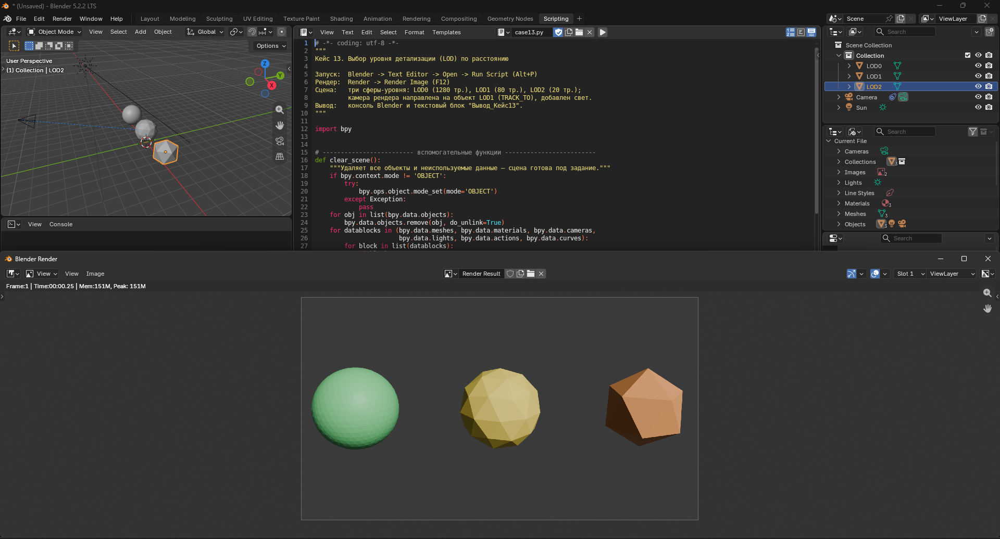

### Кейс 14. Полигональный бюджет VR-сцены
150 кубов: 125 зелёных (в бюджете) + 25 красных (превышение).

```
Бюджет сцены: 1,000,000 тр., на объект: 8,000 тр.
Максимум объектов в бюджете: 125
Сцена из 150 объектов = 1,200,000 тр. -> ПРЕВЫШЕН бюджет
```

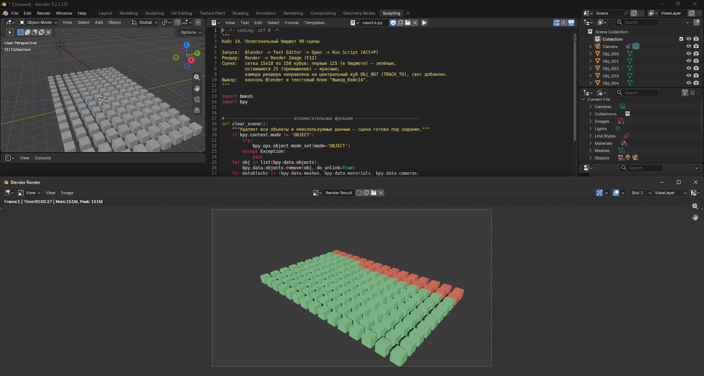

### Кейс 15. Задержка motion-to-photon
Столбцы — 4 этапа конвейера, красная линия — порог комфорта 20 мс.

```
Датчик (трекинг): 2.0 мс
Обработка: 3.0 мс
Рендер: 11.0 мс
Вывод на дисплей: 4.0 мс
Суммарная задержка motion-to-photon: 20.0 мс
Комфортно (< 20 мс)? False
```

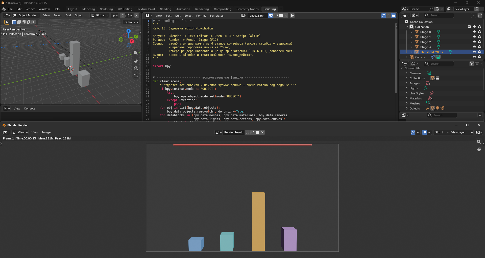

---

## Примечания

- Каждый скрипт **полностью очищает сцену** перед работой — сначала сохраните нужный `.blend`.
- Скрипты независимы: можно запускать любой по отдельности, в любом порядке.
- Помимо объектов задания каждый скрипт добавляет только камеру (с привязкой **Track To** на главный объект), свет и настройки рендера.
- Скриншоты в `Скрины/` сделаны с помощью этих же скриптов (F12).
